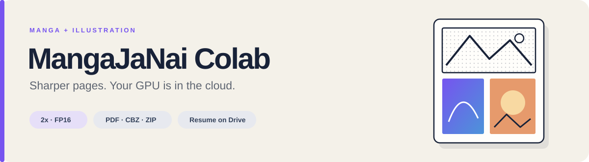

**Upscale manga and color illustrations on a Colab GPU.**

[](https://colab.research.google.com/github/0xH4KU/mangajanai-colab/blob/main/MangaJaNai_Colab.ipynb)
[](https://github.com/0xH4KU/mangajanai-colab/actions/workflows/tests.yml)
[](LICENSE)

PDFs, CBZ/ZIP archives, and image folders go in. Lossless PNG pages in verified ZIPs come out. MangaJaNai handles grayscale pages; IllustrationJaNai handles color covers and pages. Both run at **2x FP16**, with resumable progress on Google Drive.

This is an independent community notebook powered by models from [the-database](https://github.com/the-database/MangaJaNai).

## Get started

1. **Open the notebook in Colab.** Select **Runtime → Change runtime type → GPU**.
2. **Add your books to Drive.** The default input is `My Drive/Manga/input`. PDFs, CBZ/ZIP files, and image subfolders can share that folder.
3. **Choose your settings.** Set separate input/output folders, choose manga and color models, then run steps 1–4.
4. **Preview three pages.** Run step 5, inspect the saved images and timings, then run step 6 to process the batch.

You can also [download the notebook](MangaJaNai_Colab.ipynb) and upload it through Colab's **File → Upload notebook** menu.

| Default | Value |
| --- | --- |
| Manga model | 1920p, matching `2x_MangaJaNai_1920p_V1_ESRGAN_70k.pth` |
| Color model | V3denoise FDAT |
| Processing | Full page, with automatic smaller-tile retries on VRAM exhaustion |
| Progress | PNG checkpoints kept on Drive |

## Choose models

### Black-and-white manga

Set `MODEL_SELECTION` to **Auto**, or choose a fixed height. Model names describe their intended input height, not a quality ranking. Auto uses the nearest full-page height and chooses the smaller model at a midpoint, matching the [official GUI's ranges](https://github.com/the-database/MangaJaNaiConverterGui/blob/main/MangaJaNaiConverterGui/appstate2.json).

| Input height | Auto selection |
| --- | --- |
| ≤1250 | 1200p |
| 1251–1350 | 1300p |
| 1351–1450 | 1400p |
| 1451–1550 | 1500p |
| 1551–1760 | 1600p |
| 1761–1984 | 1920p |
| ≥1985 | 2048p |

Images are not resized to fit a model. Tile size does not affect model selection. An optional `MODEL_PATH` can point to the matching original official manga weight file in fixed-height mode; leave it empty for Auto. It does not override the color model.

### Color pages and illustrations

Set `ILLUSTRATION_SELECTION`. Color is detected using channel differences, and the selected model preserves RGB throughout inference.

| Choice | Direction |
| --- | --- |
| **V3denoise FDAT** — default | Clean halftone noise |
| **V3detail FDAT** | Favor detail and texture |
| **V3denoise SPAN** | Denoise with the SPAN model for lightly degraded images |
| **V3detail SPAN** | Detail with the SPAN model for lightly degraded images |
| **Keep original** | Keep color pages at their input size |

[IllustrationJaNai V3](https://github.com/the-database/MangaJaNai/releases/tag/3.0.0) is an upstream prerelease. Compare detail and denoise on a representative cover. All four included color models load through Spandrel 0.4.2 and support FP16; no FDAT patch is required.

After changing a model or output folder, rerun **steps 1 and 4**. Changing only `TILE_SIZE` needs step 1 followed by a fresh preview.

## Results and resuming

```text
Manga/output/
├── books/
│   ├── Book01.pdf.2x.zip
│   ├── Book01.pdf.2x.zip.done.json
│   ├── Book02.cbz.2x.zip
│   └── images.2x.zip
├── pages/    # Resumable PNGs
└── models/   # Verified official weights
```

Each page is encoded locally and checkpointed to Drive. ZIPs are packed directly from local PNGs, verified, uploaded, and verified again. Original inputs stay in place. Page fingerprints include input content, the actual model weights, and tile settings. Matching grayscale checkpoints from earlier 1920p versions are reusable; changing the color model only recalculates affected color pages.

Reconnect to a GPU and the same Drive, keep your settings, and run **steps 1–4, then step 6**. Incomplete books resume from valid PNGs. Completed books verify the source, settings, and ZIP checksum before skipping rendering, inference, and repacking. Verification still reads the source and ZIP; it is not an instant metadata-only check. `.part` files never count as finished.

Keep each `.done.json` beside its ZIP on Drive. You only need the ZIP to read the book. Preview deliberately checks individual pages even if a completed ZIP exists.

### Storage and cleanup

`KEEP_PAGE_CHECKPOINTS=True` keeps resumable PNGs. Set it to `False` to remove only this tool's page PNGs after a ZIP has been verified and its completion record saved. Unfinished books and previews retain progress. Inputs, model caches, and unrelated files are kept. If the ZIP is later lost after cleanup, that book must be upscaled again.

The Colab disk needs space for the current book's input, output PNGs, and ZIP. Drive stores both PNGs and ZIPs when checkpoints are kept. Upscaled PNGs can be substantially larger than source JPEGs.

## How processing works

| Stage | Behavior |
| --- | --- |
| Input | PDF/archives are copied to the Colab disk; loose images retain their folder structure. |
| PDF rendering | Full visible pages preserve rotation, crop, text, and annotations. Scans covering ≥90% of a page use native pixel density; other pages render at 1920 pixels high. |
| Inference | One active GPU model at a time. Each model remembers its own smaller-tile fallback. |
| Checkpoint | Each finished page is synchronized to Drive. Existing matching PNGs are reused. |
| Output | Verified ZIP, then an atomic completion record. Optional checkpoint cleanup happens last. |

PDF output uses `00001.png` numbering. Archive image names add `.png` to avoid collisions between a JPG and PNG with the same stem. Metadata such as `ComicInfo.xml` is retained. Loose images share `images.2x.zip` and keep their relative paths.

Per-book timings separate input preparation, PDF rendering, model loading, GPU inference, PNG encoding, Drive checkpoints, local ZIP packing/verification, and upload/verification.

### Model downloads

| First use | Download | Cached weights |
| --- | --- | --- |
| MangaJaNai V1 | ~433 MB | Seven 2x models, ~236 MB |
| IllustrationJaNai V3denoise | ~167 MB | Two 2x models, ~25 MB |
| IllustrationJaNai V3detail | ~319 MB | Two 2x models, ~25 MB |

Downloads come from official releases. Weight SHA-256 checksums are pinned; illustration packages are also checked. Only 2x weights are retained. Caches live in `OUTPUT_DIR/models` and persist across Colab sessions.

## Compatibility

- PDF, CBZ/ZIP, and single-frame **8-bit JPG/JPEG, PNG, WebP, BMP** inputs.
- Grayscale PNG output for manga; RGB PNG output for upscaled color pages.
- Transparent pixels are composited on white. Convert high-bit-depth grayscale images first and unlock encrypted PDFs.
- Color detection is heuristic: tinted paper can be classified as color.
- Tiles use 32 pixels of context and may differ slightly from full-page inference.
- Composite/vector PDF pages default to 1920 pixels high; adjust `PDF_RENDER_HEIGHT` in the engine cell for more detail.
- 4x, CBR/RAR, and EPUB conversion are outside this notebook's scope.

[Colab GPU availability and runtime limits vary](https://research.google.com/colaboratory/faq.html). Measure speed on your assigned runtime. PyTorch allocated/reserved VRAM is not the same metric as local system-memory usage.

## Development

The tests execute the notebook's engine cell directly using synthetic images and PDFs. They cover model routing, RGB preservation, tile boundaries, cache verification, resumable outputs, failed uploads, and cleanup boundaries. No GPU, Google account, or model downloads are needed.

```sh
python -m pip install -r requirements-dev.txt
python -m unittest discover -s tests -v
```

Official manga and illustration weights have also been smoke-tested locally with small CPU FP16 inputs. Full Colab CUDA performance has not been benchmarked here.

## License and credits

Copyright © 2026 HAKU. Original project code is licensed under **AGPL-3.0-only**, alongside the AGPL-licensed PDF dependency. See [LICENSE](LICENSE) and [third-party notices](THIRD_PARTY_NOTICES.md).

Model weights retain the upstream **CC BY-NC 4.0** terms. They are downloaded at runtime and are not bundled in this repository. The code license does not grant additional rights to the weights or your source artwork.

Thanks to [the-database](https://github.com/the-database/MangaJaNai) for MangaJaNai and IllustrationJaNai, [Spandrel](https://github.com/chaiNNer-org/spandrel) for architecture support, and [PyMuPDF](https://github.com/pymupdf/PyMuPDF) for PDF rendering.
